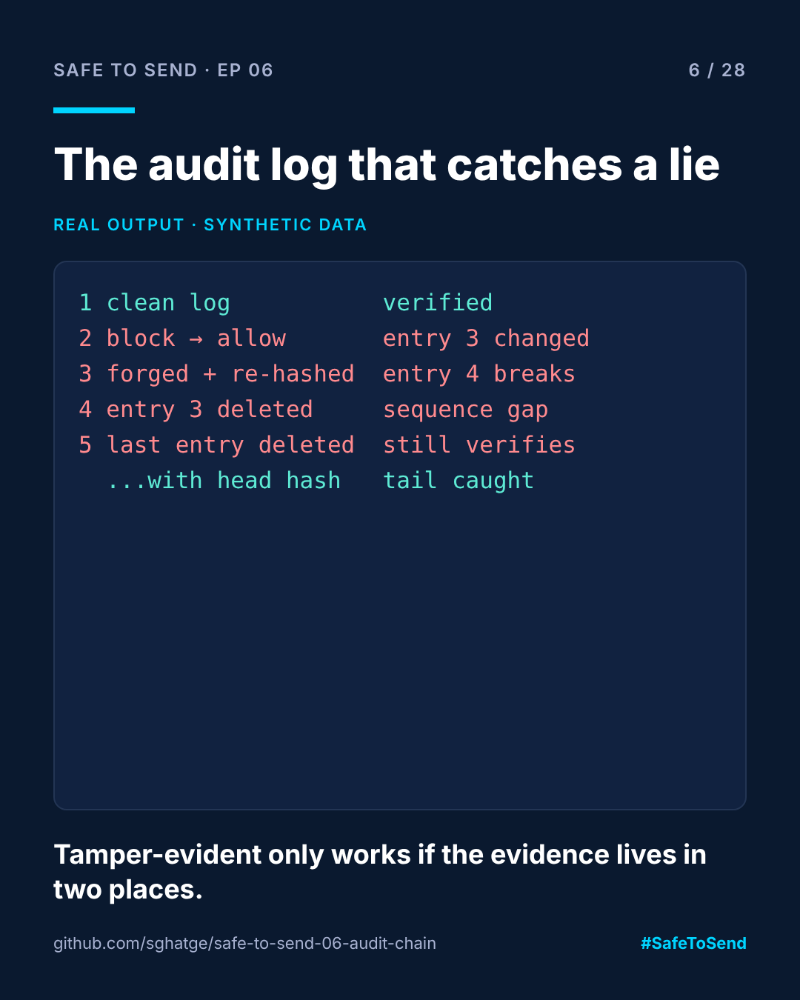

<div align="center">


**SAFE TO SEND · GOVERNED AI ENGINEERING SERIES · SAFE TO SEND 06 AUDIT CHAIN**

[GitHub Profile](https://github.com/sghatge) · [Portfolio](https://sghatge.github.io/adobe-campaign-v8-governance/)

</div>

---

# safe-to-send-06 · Audit Chain



**Safe to Send · Episode 06** — a 28-day learn-in-public series on governing AI in CRM operations.

> If agents act in your CRM, the record of what they did must be harder to change than the action itself.

## The real-world scenario

After an incident, someone opens the agent's log and changes one line from `block` to `allow`. Now the story says the agent was allowed to do what it did. With an ordinary log file, nobody can tell.

## Run it

```bash
python audit_chain.py demo
```

## Real example output

```
1. Clean log:            5 entries verified
2. 'block' -> 'allow':   entry 3: content was changed after it was written
3. Forged + re-hashed:   entry 4: does not link to the entry before it
4. Entry 3 deleted:      entry 3: sequence gap (an entry was removed)
5. Last entry deleted:   4 entries verified   <- without a stored head hash
   ...with head hash:    log ends early: the stored head hash does not match (tail deleted)
```

## The lesson most hash-chain demos skip

Line 5. A hash chain proves nothing is changed *inside* the log. It cannot tell you the log was cut short, because the remaining entries still link perfectly. The fix is cheap: store the latest hash (the "head") somewhere the agent can't write, such as a ticket, a separate system or a daily email, and verify against it.

## Use it

```python
from audit_chain import append, verify
log = []
head = append(log, {"tool": "delivery_send", "decision": "needs_approval"})
ok, message = verify(log, head)
```

## Where this fits

[ACC Agent Gate](https://github.com/sghatge/acc-agent-gate) writes every decision, including blocks, to a log like this one.

Independent project, not affiliated with Adobe. Synthetic data only. MIT · [Sangram Ghatge](https://www.linkedin.com/in/sangram-g-2369705b) · #SafeToSend
